<div align="center">



<p>
  <a href="https://cyberloop-dev.github.io/promptpad/"></a>
  
  
</p>

**Stop retyping the same prompt. Write it once, fill the blanks, reuse it forever.**

</div>

---

## ✨ Features

| | |
|---|---|
| 🧩 **`{{variables}}`** | Any `{{name}}` in your template becomes an input field automatically |
| ⚡ **Live result** | The finished prompt updates as you type; unfilled variables stay visible |
| 📋 **One-click copy** | Paste straight into your favorite chat or API playground |
| 💾 **Saved templates** | Keep your best prompts in the browser and reload them any time |
| 📦 **Import / export** | Move your library between machines as a JSON file |
| 🔒 **Local only** | No account, no server, nothing uploaded |

## 🚀 Quick start

Open the [live demo](https://cyberloop-dev.github.io/promptpad/), or:

```bash
git clone https://github.com/CyberLoop-dev/promptpad.git
cd promptpad
open index.html
```

## 🧪 Example

Template:

```text
You are a senior {{role}}.
Review this {{thing}} and give me {{count}} concrete improvements.

{{content}}
```

Fill in `role`, `thing`, `count` and `content`, hit **Copy result**, done.

## 🗂️ Where your data lives

Templates are stored in your browser's `localStorage`. Clearing site data removes them, so use **Export JSON** for a backup.

## 📄 License

MIT
